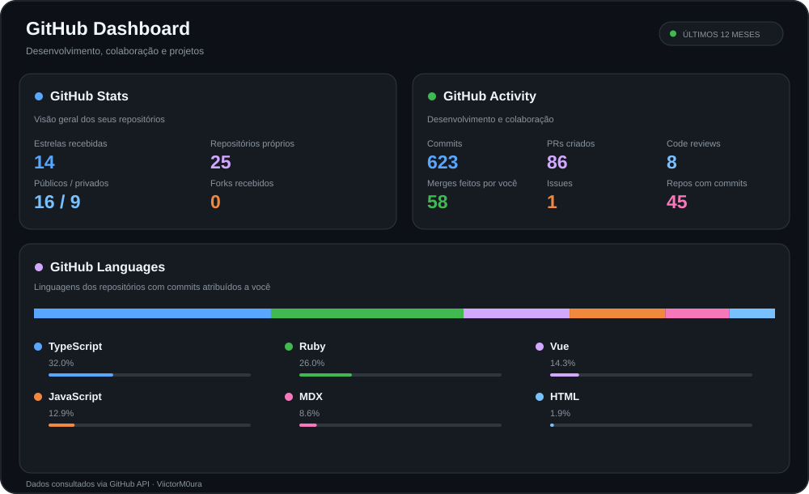

# Vitor Moura

Desenvolvimento de aplicações, integração de sistemas e soluções em cloud.

---

## Sobre mim

Sou desenvolvedor Full Stack e Analista de Sistemas, interessado em tecnologia, inovação e na construção de soluções que resolvem problemas reais.

Atuo no desenvolvimento de aplicações, integração entre sistemas, APIs, bancos de dados e soluções em cloud. Também participo do desenvolvimento colaborativo, realizando code reviews, revisando pull requests e integrando código de outros desenvolvedores.

Tenho experiência com soluções conversacionais e integrações entre plataformas, buscando construir soluções organizadas, confiáveis e alinhadas às necessidades de cada projeto.

## Tecnologias e ferramentas

**Back-end e linguagens**

  

**Front-end**

  

**Bancos de dados**

  

**Cloud e ferramentas**

  

---

## Meu GitHub

  

---

## Contribuições

  <picture>
    <source
      media="(prefers-color-scheme: dark)"
      srcset="https://raw.githubusercontent.com/viictorm0ura/viictorm0ura/output/github-snake-dark.svg"
    />
    <source
      media="(prefers-color-scheme: light)"
      srcset="https://raw.githubusercontent.com/viictorm0ura/viictorm0ura/output/github-snake.svg"
    />
    
  </picture>

---

  Transformando curiosidade em conhecimento e ideias em soluções. 🚀

